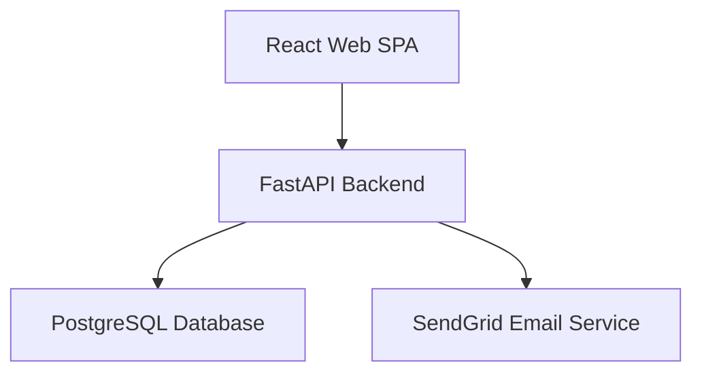
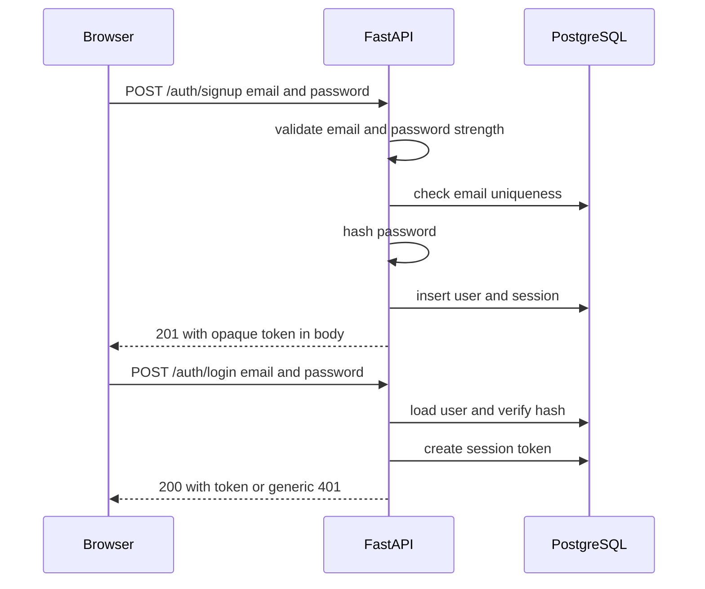
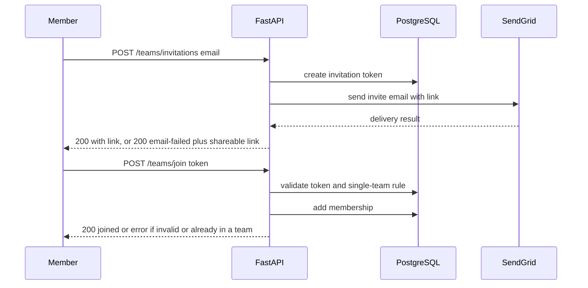
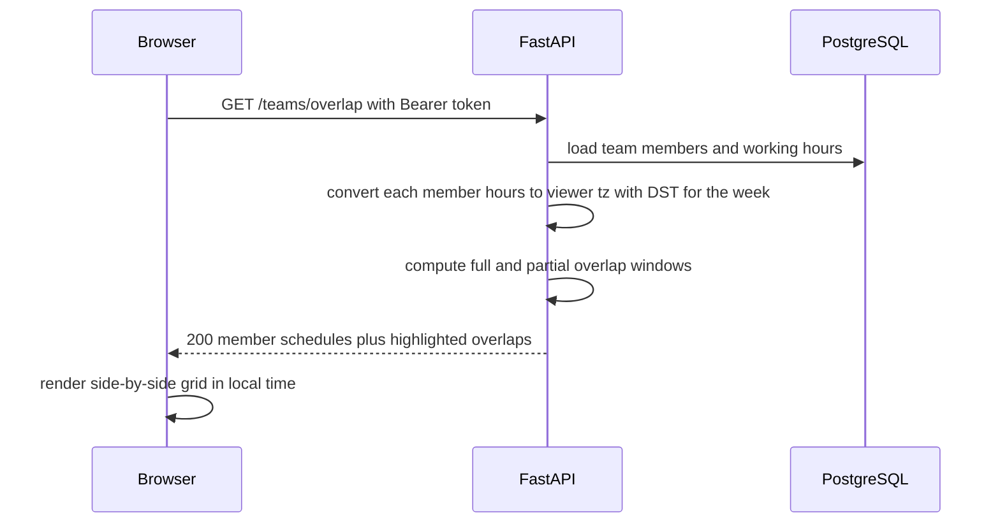
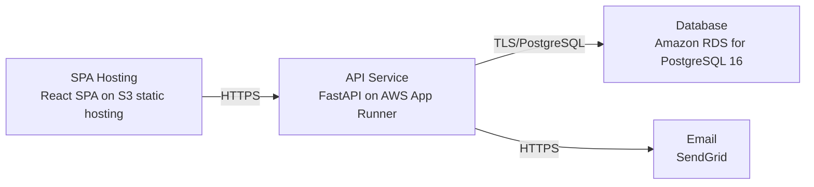

# Architecture

> Maintained by QuorQ AI SDLC. Text between `sdlc:auto` markers is regenerated; anything outside them is yours and is kept.

<!-- sdlc:auto:start narrative -->
## Overview

### ARCH-001 · approved · source: architecture:summary

sonartest is a lightweight, responsive web app helping small distributed teams (2-20 people) find overlapping working hours across time zones. Approved architecture (v1) uses React 19 SPA, FastAPI 0.115 backend, PostgreSQL 16, and AWS.

Core flows: sign up with email/password, set home time zone and recurring weekly working hours, create or join a single team via shareable invite link (emailed through SendGrid), and view all teammates' hours side by side converted to the viewer's local time with best-meeting overlap windows highlighted. Daylight-saving handled via Python/JS time-zone libraries. Out of scope: scheduling, calendar sync, native apps.

### ARCH-COMP-WEB · approved · source: architecture:component:web

React 19 SPA is the sole client, delivering a responsive UI for sign-in, profile, working-hours editing, team management, and the overlap grid.

Renders side-by-side teammate overlap grid in the viewer's local time with overlaps highlighted. Stores the opaque session token client-side and sends it as a Bearer header on API calls. Built as a Vite SPA; reads API base URL from VITE_API_BASE_URL.

### ARCH-COMP-API · approved · source: architecture:component:api

FastAPI 0.115 backend exposes the REST surface for auth, profile, working hours, teams, invitations, and overlap computation.

Enforces one-team-per-account rule, hashes passwords, manages server-side sessions, and computes DST-correct overlaps using Python's zoneinfo library.

### ARCH-COMP-DB · approved · source: architecture:component:db

PostgreSQL 16 is the relational store for users, teams, memberships, recurring weekly working hours, invitations, and server-side sessions.

Enforces email uniqueness and the single-team-per-account rule at the database level.

### ARCH-COMP-EMAIL · approved · source: architecture:component:email

SendGrid is the transactional email service used solely for delivering team invitation links.

Used by the invitation flow; on SendGrid send failure the API falls back to returning the join link directly for manual sharing (see POST /teams/invitations).

### ARCH-CP-AUTH · approved · source: architecture:critical_path:signup_signin

Critical path: account creation and sign-in.

Step 1: Account creation hashes the password and enforces strength validation. Step 2: Sign-in exchanges credentials for an opaque session token. Step 3: Bad-credential attempts return a generic failure message (no detail on whether email or password was wrong).

### ARCH-CP-INVITE · approved · source: architecture:critical_path:invite_join

Critical path: inviting and joining a team.

Step 1: An existing team member invites a teammate by email via SendGrid, with a shareable link as fallback. Step 2: The invited person opens the join link and joins the team. Step 3: The one-team-per-account rule is enforced at join time, rejecting users who already belong to a team.

### ARCH-CP-OVERLAP · approved · source: architecture:critical_path:overlap

Critical path: computing and viewing teammate schedule overlap.

Step 1: Each teammate's recurring weekly working hours are converted into the viewer's time zone for a requested week. Step 2: DST is applied per zone for that specific week. Step 3: Full and partial overlap windows are derived and returned for display.

### ARCH-ENTITIES · approved · source: architecture:entities

Five core data entities defined: users, teams, working_hours, invitations, sessions.

users: id, email, password_hash, display_name, home_timezone, team_id, created_at. teams: id, name, created_by, created_at. working_hours: id, user_id, day_of_week, start_time, end_time, is_working (one row per weekday). invitations: id, team_id, email, token, status, expires_at, created_by, created_at. sessions: id, user_id, token, created_at, last_active_at, expires_at.

### ARCH-ENDPOINTS · approved · source: architecture:endpoints

Eleven REST endpoints cover auth, profile, working hours, teams, invitations, and overlap computation.

Step-by-step surface: 1) POST /auth/signup - create account, enforce password strength and email uniqueness, store hash only, return session token. 2) POST /auth/login - sign in, return opaque session token, generic failure message on bad credentials. 3) POST /auth/logout - revoke current session token server-side. 4) GET /me - return signed-in user's profile and team state. 5) PUT /me/profile - update required non-empty display name and home time zone (from standard list). 6) GET /me/working-hours - return the user's recurring weekly schedule (7 weekdays). 7) PUT /me/working-hours - replace weekly schedule; reject end-not-after-start; unset days treated as non-working. 8) POST /teams - create one team; rejected if user already belongs to a team. 9) GET /teams/me - return current team with members' display names and home time zones. 10) POST /teams/invitations - create invite, email join link via SendGrid, return link directly on email failure. 11) POST /teams/join - accept invite token; enforce valid/unexpired token and one-team-per-account. 12) GET /teams/overlap - return each member's weekly hours converted to viewer's time zone (DST-correct for requested week) plus full and partial overlap windows.

### ARCH-DEPLOY · approved · source: architecture:deployment_nodes

Four deployment nodes: static SPA hosting, containerized API, managed Postgres, and SendGrid SaaS.

SPA Hosting: React SPA static assets on S3 static hosting. API Service: FastAPI on AWS App Runner, Python 3.12 container. Database: Amazon RDS for PostgreSQL 16. Email: SendGrid SaaS API for transactional email.

### ARCH-TECH-FRONTEND · approved · source: architecture:tech_decision:frontend

Frontend technology decision: React 19 (over Vue, Svelte alternatives).

Delivered as a responsive Vite SPA rendering the live side-by-side overlap grid, re-rendering all teammates' hours in the viewer's local time. Reads API base URL from VITE_API_BASE_URL and stores the opaque session token for Bearer auth.

### ARCH-TECH-BACKEND · approved · source: architecture:tech_decision:backend

Backend technology decision: FastAPI 0.115 (over Django REST Framework, Flask alternatives).

Hosts the modest REST surface for accounts, profiles, working hours, teams, invitations and overlap computation, using Python's zoneinfo library for DST-correct overlap math.

### ARCH-TECH-DB · approved · source: architecture:tech_decision:database

Database technology decision: PostgreSQL 16 (over MySQL, SQLite alternatives).

Stores simple, highly relational data (users, one team each, memberships, recurring weekly hours, invitations, sessions) and reliably enforces email uniqueness and the one-team-per-account rule at low scale.

### ARCH-TECH-CLOUD · approved · source: architecture:tech_decision:cloud

Cloud platform decision: AWS (over GCP, Azure alternatives).

Runs the app cheaply at low scale with managed RDS PostgreSQL, container hosting for the API, static hosting for the SPA, and easy SendGrid integration, with headroom for many small teams.
<!-- sdlc:auto:end narrative -->

<!-- sdlc:auto:start building-blocks -->
## Building Block View

| ID | Name | Technology | Responsibility | Depends on |
|---|---|---|---|---|
| web | React Web SPA | React 19 | Responsive UI for sign-in, profile, working-hours editing, team management and the side-by-side overlap grid rendered in the viewer's local time with overlaps highlighted. Stores the opaque session token and sends it as a Bearer header. | api |
| api | FastAPI Backend | FastAPI 0.115 | Exposes REST APIs for auth, profile, working hours, teams, invitations and overlap computation. Enforces one-team-per-account, hashes passwords, manages server-side sessions, and computes DST-correct overlaps. | db, email |
| db | PostgreSQL Database | PostgreSQL 16 | Relational store for users, teams, memberships, recurring weekly working hours, invitations and server-side sessions. Enforces uniqueness and the single-team rule. | — |
| email | SendGrid Email Service | SendGrid | Transactional email delivery for team invitation links. | — |

<!-- sdlc:auto:end building-blocks -->

<!-- sdlc:auto:start runtime -->
## Runtime View

### Sign-up and sign-in

Account creation with hashed password and strength validation, then token-based sign-in. Generic failure message on bad credentials.

- **Components:** web, api, db
- **Modules:** auth_router, auth_service, password_hasher, session_store
- **Key functions:** signup(email, password), login(email, password), hash_password(password), verify_password(password, hash), create_session(user_id)

### Invite and join a team

A team member invites by email (SendGrid) with a fallback shareable link, and an invited person joins via the link while enforcing one-team-per-account.

- **Components:** web, api, db, email
- **Modules:** team_router, invitation_service, email_client
- **Key functions:** create_team(user_id, name), create_invitation(team_id, email), send_invite_email(email, link), accept_invite(token, user_id)

### Overlap computation and view

Compute each teammate's working hours against the viewer's time zone for a given week, applying DST per zone, and derive full and partial overlap windows.

- **Components:** web, api, db
- **Modules:** overlap_router, overlap_service, timezone_utils
- **Key functions:** get_overlap(viewer_id, week_date), to_viewer_tz(hours, home_tz, viewer_tz, date), compute_overlaps(members_hours)

<!-- sdlc:auto:end runtime -->

<!-- sdlc:auto:start deployment-view -->
## Deployment View

| Name | Service | Runtime | Scaling | Environment |
|---|---|---|---|---|
| SPA Hosting | React SPA on S3 static hosting | Static assets | n/a (static) | dev |
| API Service | FastAPI on AWS App Runner | Python 3.12 container | 1 instance, auto-scale on request volume | dev |
| Database | Amazon RDS for PostgreSQL 16 | PostgreSQL 16 | single small instance | dev |
| Email | SendGrid | SaaS API | managed by provider | dev |

| Source | Target | Protocol |
|---|---|---|
| SPA Hosting | API Service | HTTPS |
| API Service | Database | TLS/PostgreSQL |
| API Service | Email | HTTPS |

<!-- sdlc:auto:end deployment-view -->

<!-- sdlc:auto:start decisions -->
## Architecture Decisions

| Layer | Choice | ADR |
|---|---|---|
| Frontend | React 19 | [ADR-0001](adr/frontend.md) |
| Backend | FastAPI 0.115 | [ADR-0002](adr/backend.md) |
| Database | PostgreSQL 16 | [ADR-0003](adr/database.md) |
| Cloud | AWS | [ADR-0004](adr/cloud.md) |
<!-- sdlc:auto:end decisions -->

<!-- sdlc:auto:start links -->
## Related Documents

- [Data Model](data-model.md)
- [API Specification](api/openapi.yaml)
- [Architecture Decision Records](adr/README.md)
<!-- sdlc:auto:end links -->
