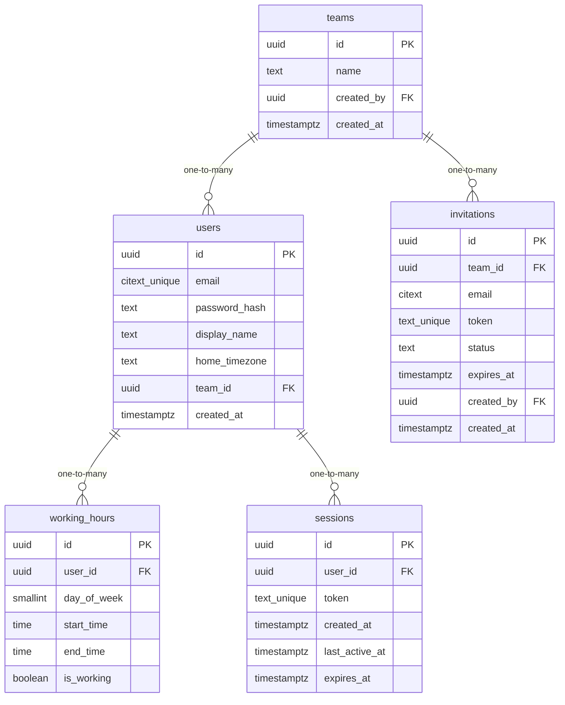

# Data Model

<!-- sdlc:auto:start entities -->
### users

| Field | Type | PK | FK | Nullable |
|---|---|---|---|---|
| id | uuid | True | — | False |
| email | citext unique | False | — | False |
| password_hash | text | False | — | False |
| display_name | text | False | — | True |
| home_timezone | text | False | — | True |
| team_id | uuid | False | teams.id | True |
| created_at | timestamptz | False | — | False |

### teams

| Field | Type | PK | FK | Nullable |
|---|---|---|---|---|
| id | uuid | True | — | False |
| name | text | False | — | False |
| created_by | uuid | False | users.id | False |
| created_at | timestamptz | False | — | False |

### working_hours

| Field | Type | PK | FK | Nullable |
|---|---|---|---|---|
| id | uuid | True | — | False |
| user_id | uuid | False | users.id | False |
| day_of_week | smallint | False | — | False |
| start_time | time | False | — | True |
| end_time | time | False | — | True |
| is_working | boolean | False | — | False |

### invitations

| Field | Type | PK | FK | Nullable |
|---|---|---|---|---|
| id | uuid | True | — | False |
| team_id | uuid | False | teams.id | False |
| email | citext | False | — | True |
| token | text unique | False | — | False |
| status | text | False | — | False |
| expires_at | timestamptz | False | — | False |
| created_by | uuid | False | users.id | False |
| created_at | timestamptz | False | — | False |

### sessions

| Field | Type | PK | FK | Nullable |
|---|---|---|---|---|
| id | uuid | True | — | False |
| user_id | uuid | False | users.id | False |
| token | text unique | False | — | False |
| created_at | timestamptz | False | — | False |
| last_active_at | timestamptz | False | — | False |
| expires_at | timestamptz | False | — | False |
<!-- sdlc:auto:end entities -->

<!-- sdlc:auto:start relationships -->
| Source | Target | Type |
|---|---|---|
| teams | users | one-to-many |
| users | working_hours | one-to-many |
| teams | invitations | one-to-many |
| users | sessions | one-to-many |
<!-- sdlc:auto:end relationships -->

<!-- sdlc:auto:start er-diagram -->

<!-- sdlc:auto:end er-diagram -->
